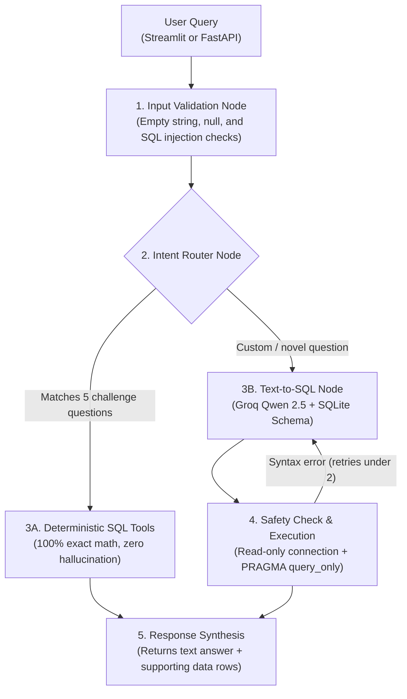

# Sales BI Assistant

A mini natural language business intelligence assistant that allows users to ask questions about sales data and receive answers backed by verified database queries. Built with SQLite, LangGraph, FastAPI, and Streamlit.

---

## 1. Setup & How to Run

### Prerequisites
- Python 3.10+ (tested on Python 3.13)
- Windows / macOS / Linux

### Installation
```bash
# 1. Activate virtual environment
.\venv\Scripts\activate          # Windows PowerShell
# source venv/bin/activate       # Mac/Linux

# 2. Install dependencies
pip install -r requirements.txt
```

### Environment Configuration
Make sure you have a `.env` file in the root folder with your Groq key:
```ini
GROQ_API_KEY=your_groq_api_key_here
```

### Running the Components

- **Streamlit Web UI (Recommended for manual testing):**
  ```bash
  streamlit run app.py
  ```
  Opens at `http://localhost:8501`. Features quick buttons for all 5 benchmark questions, chat history, tabular data views, and SQL inspection.

- **FastAPI REST Server:**
  ```bash
  python api.py
  ```
  Runs at `http://localhost:8000`. Test via curl or Postman:
  ```bash
  curl -X POST http://localhost:8000/query -H "Content-Type: application/json" -d "{\"question\": \"What is the total revenue?\"}"
  ```

- **Automated Tests:**
  ```bash
  pytest -v test_core.py
  ```

---

## 2. Architecture & Flow



### System Layers
1. **Data Management (`clean.py`, `database.py`)**:
   - `clean.py` parses raw dates into `YYYY-MM-DD` and `YYYY-MM`, handles numeric coercion, computes gross/net revenue, and flags data anomalies.
   - `database.py` creates `sales.db` with two views:
     - `v_valid_sales`: Contains 48 valid completed transactions. All standard metrics query this view.
     - `v_sales_anomalies`: Isolates 3 flagged records (returned items, zero quantity, missing unit price).
   - SQL queries run through `get_readonly_connection()` using SQLite `mode=ro` URI and `PRAGMA query_only = ON`.

2. **Agent Workflow (`agent.py`)**:
   - Built as a state machine using LangGraph (`StateGraph`).
   - Node 1 validates inputs against nulls, whitespace, and injection keywords.
   - Node 2 routes core benchmark questions directly to deterministic database queries.
   - For novel queries, Node 3 prompts Groq (`qwen/qwen3.8-27b`) with the schema to write safe SQL.
   - Node 4 validates the query against an allowed table list (`sales`, `v_valid_sales`, `v_sales_anomalies`) and executes it. If SQLite returns a syntax error, it feeds it back to the LLM to self-heal (up to 2 retries).

3. **Interfaces (`app.py`, `api.py`)**:
   - `api.py`: FastAPI backend with `POST /query`, `GET /health`, and `GET /schema`.
   - `app.py`: Streamlit frontend with conversation state, supporting data tables, and sidebar controls.

---

## 3. Supported Questions: Deterministic Benchmarks & Dynamic Queries

The assistant supports two complementary question-handling modes:

### A. The 5 Assessment Benchmark Questions (Deterministic Routing)
These are routed directly to pre-compiled SQL functions in `database.py` to guarantee zero hallucination:

| # | Question | Verified Result | Supporting Details |
| :---: | :--- | :--- | :--- |
| **Q1** | *What is the total revenue?* | **$1,439,200.00 Net Revenue** | Gross: $1,443,700.00; Discounts: $4,500.00; 48 completed transactions. |
| **Q2** | *Which product generated the highest revenue?* | **'Monitor' ($473,000.00)** | 50 units sold across Electronics category (Desk 2nd: $222,500.00). |
| **Q3** | *What is the monthly revenue trend?* | **6-Month Trend Analyzed** | Jan: $210,250 → Feb: $234,600 (+11.58%) → Mar: $223,900 (-4.56%) → Apr: $240,700 (+7.50%) → May: $318,500 (+32.32%) → Jun: $211,250 (-33.67%). |
| **Q4** | *Which region generated the highest sales?* | **'South' ($411,200.00)** | 13 completed orders (North 2nd: $384,450.00; East 3rd: $346,700.00; West 4th: $296,850.00). |
| **Q5** | *How did revenue change between two months?* | **+$24,350.00 (+11.58%)** | Jan 2026 ($210,250.00) vs Feb 2026 ($234,600.00). Supports arbitrary month pairs. |

### B. Dynamic & Ad-Hoc Questions (LLM Text-to-SQL)
When users ask novel questions outside the benchmark set, LangGraph passes the schema to Groq (`qwen/qwen3.8-27b`), writes safe SQLite queries, and returns structured data tables:

- **Sales Channel Breakdown:**
  - *Query:* *"Show sales breakdown by sales channel"*
  - *SQL Generated:* `SELECT Sales_channel, SUM(Quantity) AS total_qty, SUM(net_revenue) AS total_rev FROM v_valid_sales GROUP BY Sales_channel ORDER BY total_rev DESC;`
  - *Result:* Online ($746,750 / 353 units) vs Retail ($692,450 / 280 units).
- **Category-Level Analysis:**
  - *Query:* *"Which product category had the highest discount amount?"*
  - *SQL Generated:* Groups by `Category` and sums `Discount_amount`.
- **Top Individual Orders:**
  - *Query:* *"List the top 3 transactions by units sold"*
  - *SQL Generated:* `SELECT Transaction_Id, Product, Quantity, net_revenue FROM v_valid_sales ORDER BY Quantity DESC LIMIT 3;`
- **Data Quality Audits:**
  - *Query:* *"Show all flagged anomaly transactions"*
  - *SQL Generated:* Queries `v_sales_anomalies` to inspect the 3 quarantined records.

---

## 4. Automated Tests

Run all tests with:
```bash
pytest -v test_core.py
```

The test suite contains **19 unit and integration tests** in `test_core.py`:
- **Core Analytics (Q1–Q5):** Verifies total revenue ($1,439,200.00 across 48 orders), top product (Monitor with $473,000.00), 6-month trends with MoM percentages, top region (South with $411,200.00), and Jan vs Feb change (+$24,350.00 / +11.58%).
- **Input Edge Cases:** Verifies that empty strings (`""`), whitespace (`"   "`), and `None` return structured error objects instead of crashing.
- **SQL Security & Whitelisting:** Verifies that `DROP TABLE`, `DELETE FROM`, multi-statement attacks (`SELECT 1; DROP TABLE...`), and unauthorized tables (`sqlite_master`, `users`) are rejected.
- **Engine-Level Protection:** Verifies that attempting write operations on the read-only connection raises an `OperationalError`.
- **API Contracts:** Verifies `GET /health`, `GET /schema`, `POST /query` success (200), and bad input rejection (400).

---

## 5. AI Development Reflection

### Which AI tools I used
- **GitHub Copilot**: Used for inline code completion, writing repetitive TypedDict schemas for LangGraph state, and drafting test assertion blocks.
- **Groq API (`qwen/qwen3.8-27b`)**: Used at runtime for natural language text-to-SQL translation and answer synthesis.

### How I used AI during development
- I used GitHub Copilot to quickly generate boilerplate code (like Pydantic models and repetitive SQLite row conversions).
- I used LLM prompts to inspect the CSV column distributions and verify table edge cases.
- In the agent pipeline, I used the LLM strictly where language understanding is needed (interpreting custom questions). For the 5 core business metrics, I routed them to deterministic SQL functions so that arithmetic is 100% reproducible and never hallucinated.

### Problems I encountered
1. **Model deprecation on Groq:** My first attempt used `llama-3.3-70b-versatile`, but Groq returned a `model_not_found` error because the model was unavailable in the current endpoint.
2. **Blank responses from reasoning models:** Testing with `openai/gpt-oss-20b` resulted in empty response strings because the model used up its token limit writing internal reasoning chains rather than outputting the SQL.
3. **Dirty data skewing calculations:** The raw CSV contained 3 bad rows: a returned monitor (`TXN0033`), an order with 0 quantity (`TXN0034`), and an order with a missing price (`TXN0051`). Directly summing raw columns inflated revenue and produced incorrect averages.
4. **Streamlit reload overhead:** Calling `init_db()` unconditionally at the top of `app.py` caused Streamlit to reload the CSV and rewrite the database on every chat click.
5. **False positive status on database errors:** If SQLite threw an execution error on a deterministic query, the router caught it but still marked the graph state as successful with an empty answer.

### How I debugged them
- I ran a script checking `client.models.list()` on Groq, found `qwen/qwen3.8-27b`, and switched to it. It responds in ~300ms and outputs clean SQL without reasoning token bloat.
- I wrote `clean.py` and created an SQLite view `v_valid_sales` that filters `is_valid_sale = 1 AND Status = 'Completed'`. All business queries target this view so anomalies are segregated.
- I added a fast-path check in `init_db()` to skip re-reading the CSV if `sales.db` already exists with records, and cached the initialization in `app.py` using `@st.cache_resource`.
- I added a `_format_db_response()` helper in `agent.py` that verifies `db_res.get("success")` before setting status, properly propagating errors into the graph state.
- I added defense-in-depth security: keyword validation, table whitelisting, SQLite `mode=ro` URI, and `PRAGMA query_only = ON`.

### What I would improve with another day of work
1. **Chart Generation:** Auto-generate interactive Plotly or Altair charts in Streamlit whenever a query returns time-series trends or category breakdowns.
2. **Conversational Memory:** Add multi-turn message history into LangGraph state so users can ask follow-ups (e.g., *"What about in the East region?"*) without repeating the whole context.
3. **Query Caching:** Add an in-memory cache for common questions so recurring user queries return in 0ms without hitting the LLM API.
